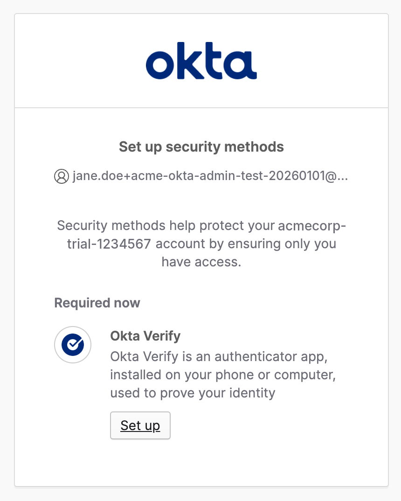
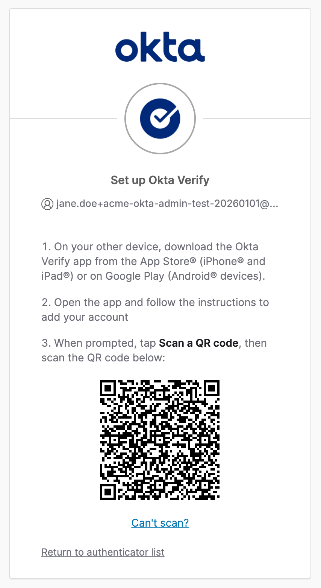
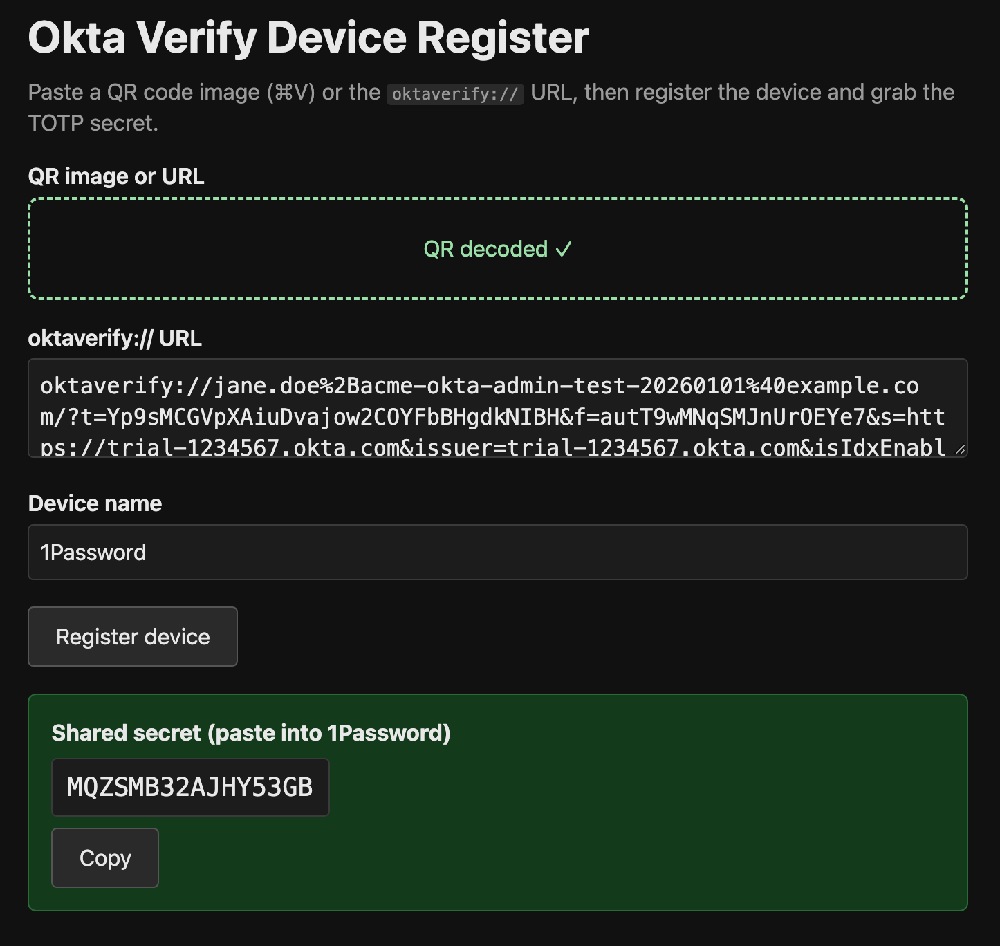

If you're using the Okta Verify app and are as annoyed by it as I am, I have good news for you. Over the weekend I decompiled the app, deobfuscated all the relevant code, figured out the protocol and ported the registration code to a simple [web app][1].

If you have an existing Okta account or you are in the process of registering a new one, you can just enroll this web app instead of Okta Verify and get the TOTP secret, which you can add to any TOTP app like Google Authenticator, 2FAS, Aegis or what have you. If you're using a password manager for TOTP codes, that would work as well.

In the Okta settings, go to Security Methods -> Okta Verify -> Set up another. If you're registering a new account, Okta asks for it right away.

Click Set up.

Take a screenshot of the QR code and just paste it into the [app][1].

Change the device name if you like and press Register device. You'll get a TOTP secret that you can add to your TOTP app or password manager.

The source code is on [GitHub][2].

[1]: https://okta-totp.detunized.workers.dev/
[2]: https://github.com/detunized/okta-totp
