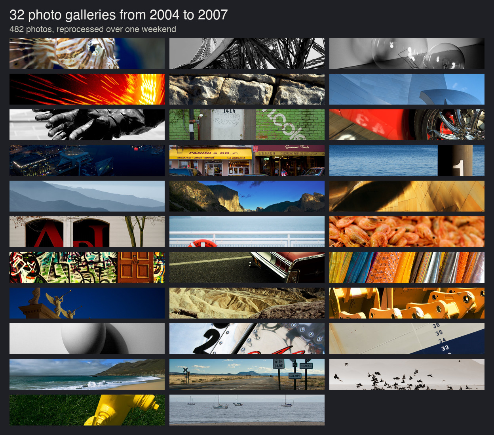
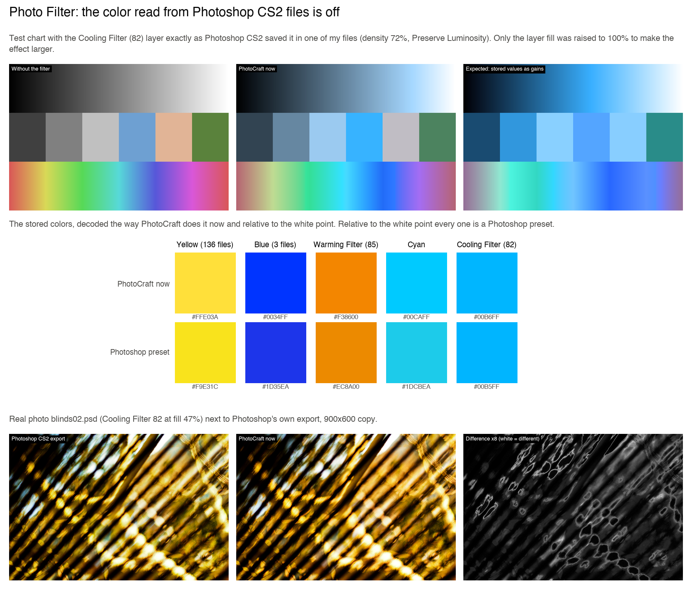
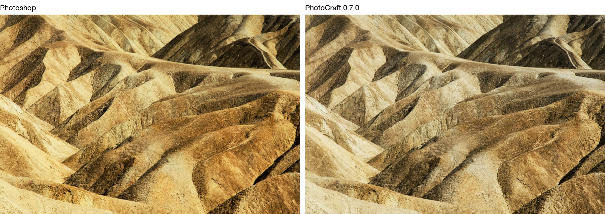
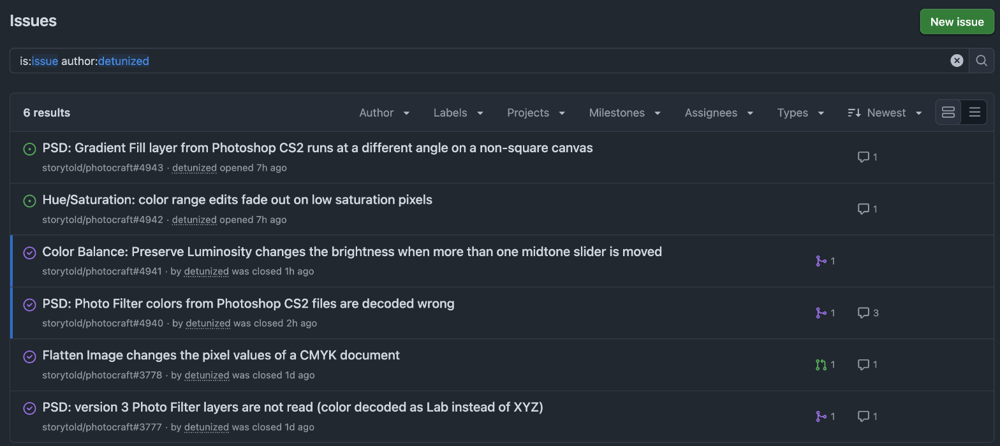

Last week there was a lot of buzz about Photoshop and other Adobe products being cloned in Rust and open sourced. Anyone can use them for free. Of course I had to check them out. PhotoCraft, the Photoshop one, really looks a lot like the real thing. But it's cross platform and free. And it loads FAAAAST!

And it reminded me of the mountain of old photos I've been copying from hard drive to hard drive for 20 years. About 20 GB of stuff from 2004 to 2007, the Photoshop CS2 days. PSDs with adjustment layers, JPEGs exported in every size I ever needed for LiveJournal and my old blog, web galleries, panoramas and duplicates of duplicates. I don't have Photoshop anymore, so I never got around to sorting it out. Now I had no excuse.

## The weekend

I didn't do it by hand, of course. I pointed Claude at the folder and let the agents do the grunt work. They matched every JPEG to the PSD it came from and found all the duplicates. For each photo they also figured out which version was the best one. Nothing got deleted. Every file that wasn't needed, almost 1,800 of them, went into a separate folder with a note explaining why. I'll delete those myself once I've had a look.

And they found four PSDs with a single flipped bit in the image data. I guess that's what 20 years of copying files around does. Photoshop's own exports of those files from 2016 already had colored bands across them, so the damage is older than that. The agents tracked down the bits and flipped them back. Whoa!

Then they built me a little web page to pick the photos I liked. After that it was mostly mechanical. Watermarked copies for the blog, banners, gallery pages and full resolution backups in Google Photos albums. By Monday there were 32 new galleries with 482 photos on the [photo page](/photo/), something I hadn't managed to do in 20 years.

## The bugs

While the agents were rendering the PSDs, they noticed that some of PhotoCraft's renders didn't quite match the JPEGs Photoshop had exported from the same files. A few photos with a Photo Filter layer came out noticeably cooler, and PhotoCraft complained that it couldn't read the Photo Filter settings at all. A CMYK file changed its colors when it got flattened. I reported both of these on Sunday and both were fixed the next day.

And then I realized I was sitting on some valuable data. Hundreds of PSDs from Photoshop CS2 together with full size JPEGs that Photoshop itself had exported from them. That's a perfect reference. If PhotoCraft renders a PSD the same way as Photoshop, the two images should match.

So I let a few agents loose to compare them and figure out what was broken and why. Each agent got a group of suspicious files and the PhotoCraft source code. Between them they rendered 414 PSDs and compared each one with the Photoshop export. Then they went after every difference. A lot of the leads turned out to be nothing. There were 19 files without a color profile that looked wrong, but Photoshop had simply assumed Adobe RGB for them. Some differences came from the JPEG encoder in the comparison itself. But four were real. Each one came with test files and side by side images, and most of the time with the line of code to blame and a possible fix.

My favorite one is the Photo Filter again. After the first fix PhotoCraft could read the layer, but it still got the color slightly wrong. Photoshop stores it as XYZ values and PhotoCraft didn't scale them the right way. Once read correctly, the colors in my files matched Photoshop's built-in presets, down to the hex code. Yellow is `#F9E31C`, Cooling Filter (82) is `#00B5FF` and so on, which is hard to argue with.

Most of the differences were small, a few levels out of 255. You need the two images side by side to notice them. But some were way off, like this one from the first report, before the fix:

## The score

Six reports so far. Four of them are already fixed, two of those on the same day I reported them. A fifth turned out to be fixed by someone else a few hours before I reported it. The sixth, a gradient that runs at a slightly different angle, is still being discussed. Current Photoshop seems to do it the same way as PhotoCraft, so it might have something to do with how old the file is.

The whole thing cost me about 25% of my weekly budget on Claude Max. The last four reports say at the top that an agent found them and that they might need another look, so the maintainers know what they're dealing with.

## Why bug reports

In this time of AI-assisted software development, I have a feeling that a detailed, well-researched bug report is worth more to a project than a patch. A patch from a stranger needs to be reviewed, tested and scanned for security issues. A good bug report with examples and a possible fix can go straight to the maintainers and their own agents. They can pick it up, fix it and verify the fix with the attached test cases.

Dear PhotoCraft developers, thank you for the quick fixes. I have more old PSDs where these came from.
